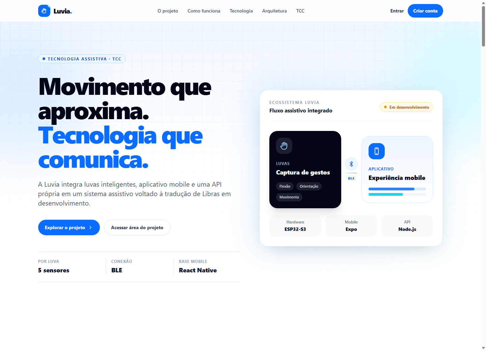
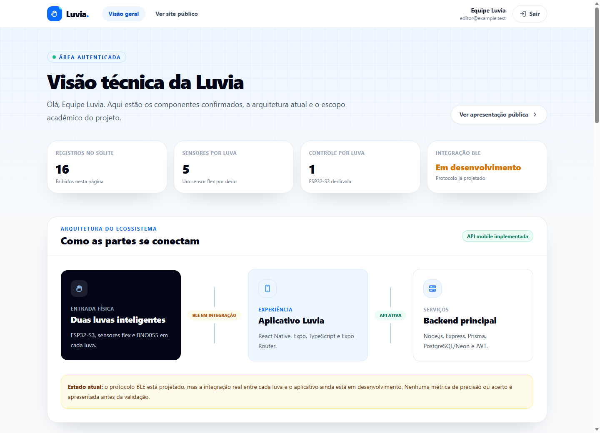
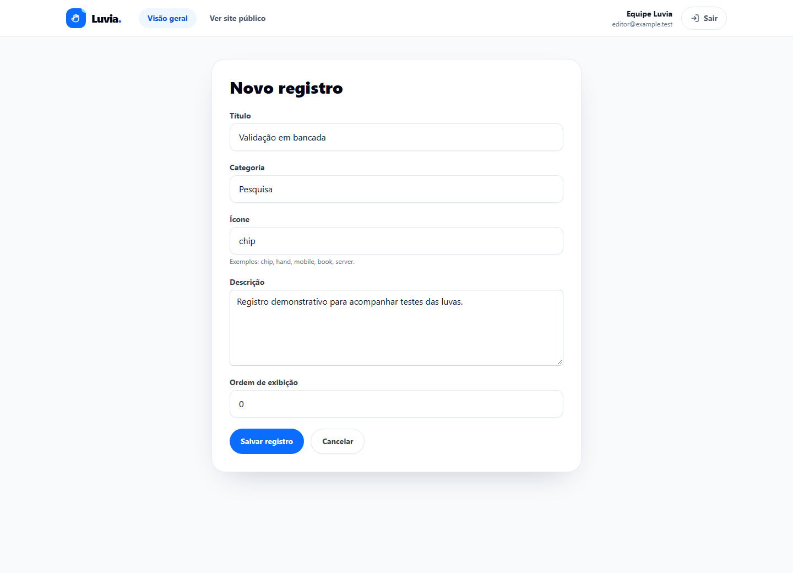
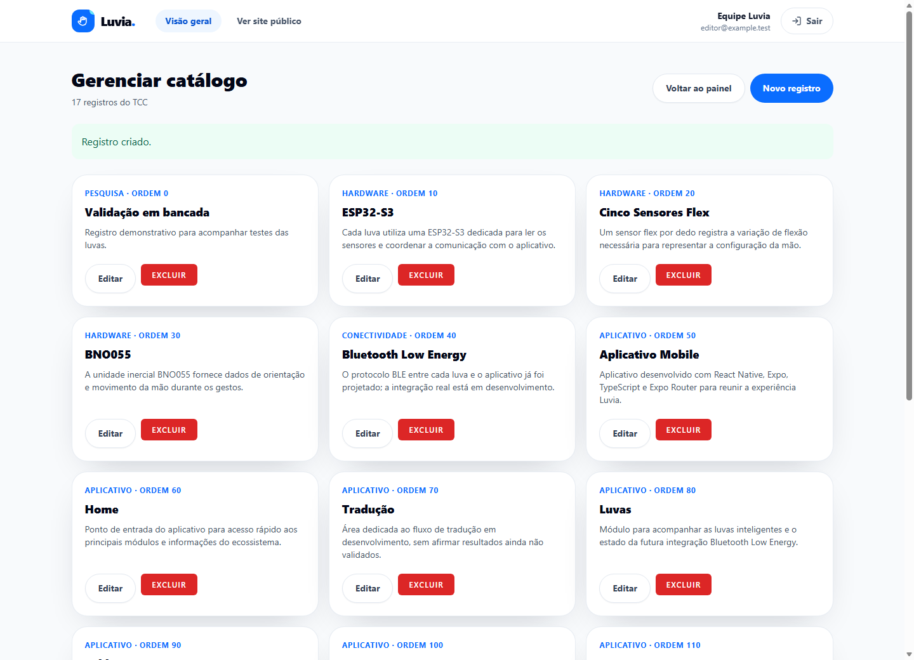
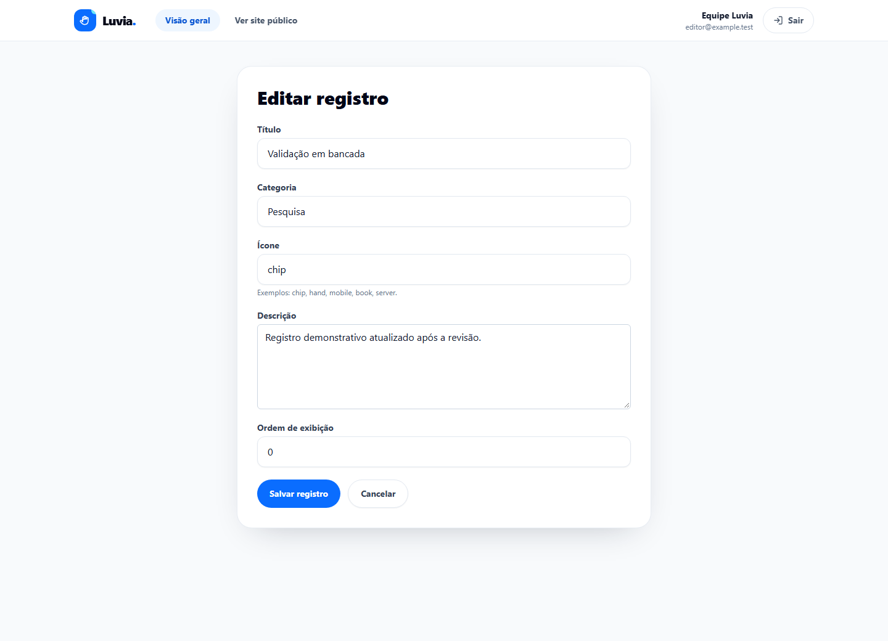
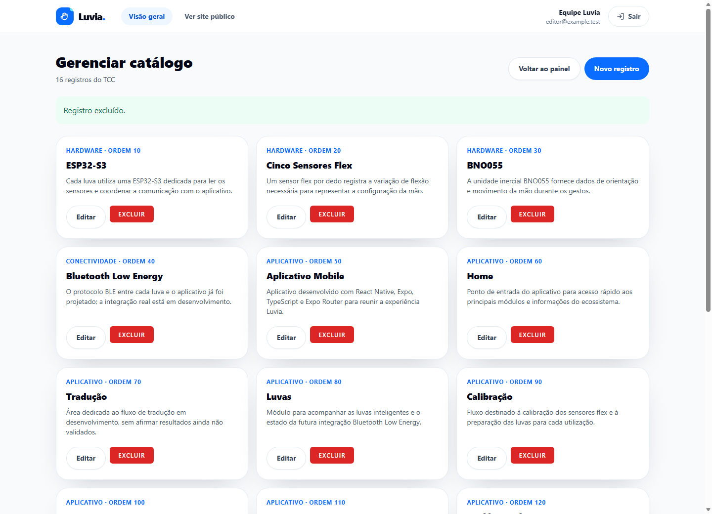
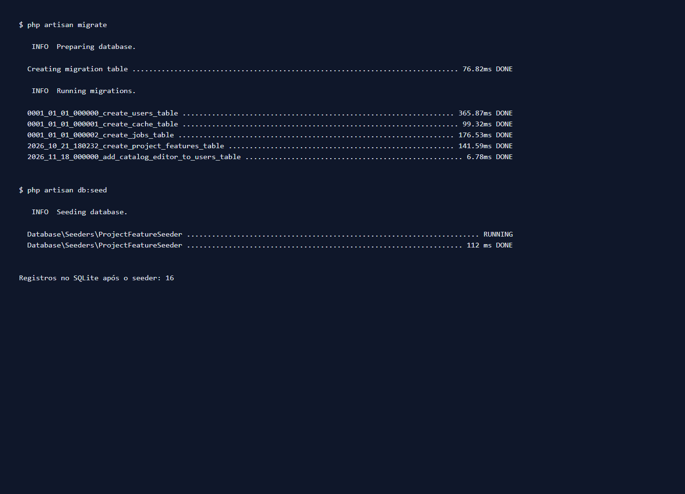
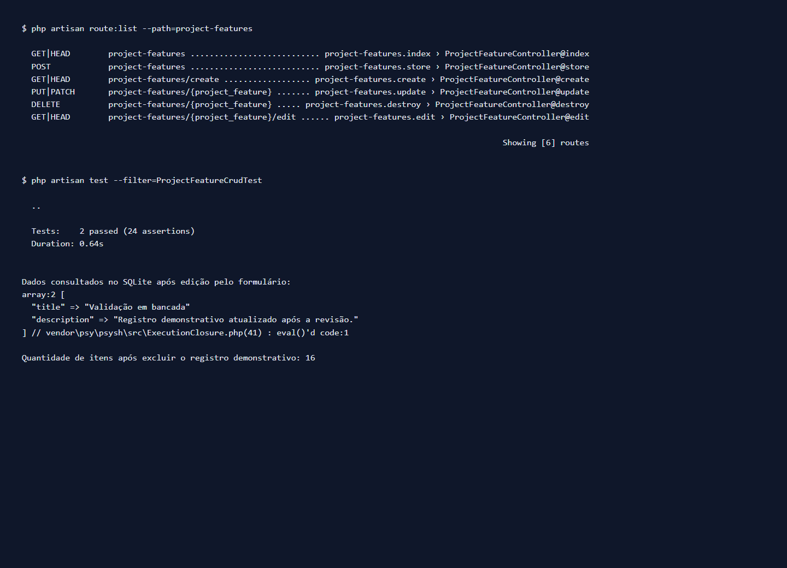

# Luvia — site do TCC

Luvia é um projeto de acessibilidade que combina duas luvas inteligentes e um aplicativo móvel para explorar a tradução de sinais em Libras. Cada luva reúne uma ESP32-S3, cinco sensores flex e uma unidade inercial BNO055. A integração Bluetooth Low Energy entre as luvas e o aplicativo está em desenvolvimento. O aplicativo utiliza React Native, Expo e TypeScript e se comunica com uma API Node.js/Express que usa Prisma, PostgreSQL/Neon e JWT.

Este repositório contém o site acadêmico de apresentação e o catálogo técnico do projeto. O site usa Laravel 12, Breeze, Blade, Tailwind CSS, Vite e SQLite. A página inicial e o dashboard consultam a tabela `project_features` e exibem todos os registros, incluindo hardware, conectividade, aplicativo e backend.

## Executar em localhost

Instale PHP 8.2 ou superior com `pdo_sqlite`, Composer e Node.js 22 ou superior com npm. Na raiz do projeto, execute:

```sh
composer install
php -r "file_exists('.env') || copy('.env.example', '.env');"
php artisan key:generate
php -r "file_exists('database/database.sqlite') || touch('database/database.sqlite');"
php artisan migrate --seed
npm ci
npm run build
php artisan serve
```

Abra [localhost:8000](http://localhost:8000). Para desenvolvimento com atualização automática do CSS e JS, execute `npm run dev` em outro terminal enquanto o servidor PHP estiver rodando.

## Acesso e CRUD

1. Cadastre uma conta em `/register` e acesse o painel em `/dashboard`.
2. Para liberar a edição dessa conta, execute `php artisan luvia:catalog-editor seu-email@exemplo.com`. Use `--revoke` para revogar a permissão.
3. No painel, abra **Gerenciar catálogo**. A página lista os registros e oferece **Novo registro**, **Editar** e **Excluir**. As alterações aparecem no painel e no catálogo público.
4. O Breeze fornece login, registro e recuperação de senha. Em desenvolvimento, com `MAIL_MAILER=log`, o link de redefinição é gravado no log em `storage/logs`. Para envio real, configure o serviço de e-mail no `.env`.

| Ação | Método e endereço |
| --- | --- |
| Listar | `GET /project-features` |
| Abrir formulário de criação | `GET /project-features/create` |
| Criar | `POST /project-features` |
| Abrir formulário de edição | `GET /project-features/{id}/edit` |
| Atualizar | `PUT /project-features/{id}` |
| Excluir | `DELETE /project-features/{id}` |

As rotas de edição usam os middlewares `auth` e `can:manage-catalog`. Visitantes são direcionados ao login e contas sem permissão recebem HTTP 403 ao tentar acessar o catálogo administrativo. A rota `Route::fallback` exibe uma página personalizada com HTTP 404 para páginas inexistentes.

## Banco de dados e testes

As [migrações](database/migrations) criam as tabelas de usuários, recuperação de senha, sessões e catálogo. O [seeder do catálogo](database/seeders/ProjectFeatureSeeder.php) carrega 16 registros iniciais usando o título como chave. Se executar o seeder novamente, ele repõe os itens padrão excluídos e atualiza os dados dos títulos padrão existentes.

```sh
php artisan migrate:status
php artisan db:seed
php artisan test
```

O [controller](app/Http/Controllers/ProjectFeatureController.php) usa o Eloquent e a [validação das requisições](app/Http/Requests/SaveProjectFeatureRequest.php) protege os dados gravados. Os [testes de integração](tests/Feature/ProjectFeatureCrudTest.php) exercitam as quatro operações, verificam a persistência e conferem as permissões de acesso.

## Capturas do projeto

### Site e painel em localhost





### CRUD no frontend

**Criar** um registro no formulário administrativo.



**Consultar** o registro criado na listagem.



**Editar** a descrição do registro.



**Excluir** o registro e conferir a confirmação na listagem.



### Banco de dados e CRUD no backend

Saída do Artisan durante a aplicação das migrações e do seeder em um SQLite de demonstração.



Rotas do controller, testes das quatro operações e resultado das consultas após a edição e a exclusão pela interface.


